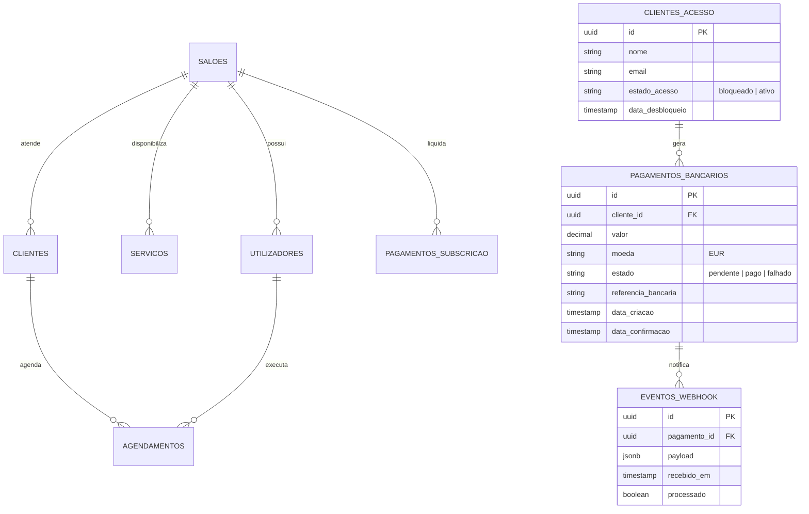
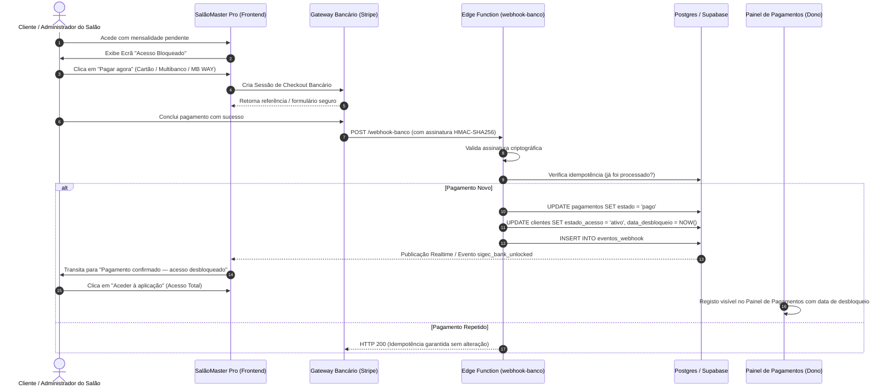

# SalãoMaster Pro - Sistema de Gestão & Agendamento para Salões de Cabeleireiro

[](https://github.com/CentauroPt/gestao-cabeleireiro)
[](https://react.dev/)
[](https://www.typescriptlang.org/)
[](https://vitejs.dev/)
[](https://tailwindcss.com/)
[](https://supabase.com/)
[](https://stripe.com/)
[](#-direitos-de-autor--propriedade-intelectual)
[](#-arquitetura-t%C3%A9cnica)

> **SalãoMaster Pro** é uma solução web corporativa de agendamento, fidelização de clientes e gestão empresarial desenvolvida à medida para salões de cabeleireiro, barbearias e espaços de estética. Projetada sob uma arquitetura **Multi-Tenant com isolamento rigoroso de dados**, combina controlo de acessos por funções (**RBAC**), agendamento inteligente anti-sobreposição, gestão técnica de clientes (CRM) e um sistema completo de **checkout bancário online com desbloqueio automático imediato via webhook bancário idempotente**.

---

## 📑 Índice Geral

1. [Visão Geral & Proposta de Valor](#-visão-geral--proposta-de-valor)
2. [Principais Módulos & Funcionalidades](#-principais-módulos--funcionalidades)
   - [1. Agenda de Marcações & Calendário em Tempo Real](#1-agenda-de-marcações--calendário-em-tempo-real)
   - [2. CRM & Fichas Técnicas de Clientes](#2-crm--fichas-técnicas-de-clientes)
   - [3. Gestão de Equipa & Controlo de Acessos (RBAC)](#3-gestão-de-equipa--controlo-de-acessos-rbac)
   - [4. Catálogo de Serviços & Tabela de Preços](#4-catálogo-de-serviços--tabela-de-preços)
   - [5. Subscrição SaaS, Checkout Bancário & Desbloqueio Automático](#5-subscrição-saas-checkout-bancário--desbloqueio-automático)
   - [6. Consola do Programador (Super Admin / Master)](#6-consola-do-programador-super-admin--master)
3. [Arquitetura Técnica & Stack Tecnológico](#-arquitetura-técnica--stack-tecnológico)
4. [Modelo de Dados & Esquema da Base de Dados](#-modelo-de-dados--esquema-da-base-de-dados)
5. [Fluxo do Checkout Bancário & Webhook](#-fluxo-do-checkout-bancário--webhook)
6. [Instalação & Execução Local](#-instalação--execução-local)
7. [Variáveis de Ambiente](#-variáveis-de-ambiente)
8. [Publicação & Deploy](#-publicação--deploy)
9. [Segurança & Boas Práticas](#-segurança--boas-práticas)
10. [Direitos de Autor & Propriedade Intelectual](#-direitos-de-autor--propriedade-intelectual)

---

## 🎯 Visão Geral & Proposta de Valor

O **SalãoMaster Pro** resolve os desafios centrais da operação diária de um salão de beleza moderno:

- **100% Web & Responsivo:** Opera nativamente em qualquer navegador moderno (computadores, tablets e telemóveis) sem necessidade de instalação de binários ou executáveis locais.
- **Multi-Tenant Isolado:** Cada salão registado possui o seu identificador próprio (`salonId`), garantindo confidencialidade e total segregação de clientes, agendamentos, faturação e colaboradores.
- **Operação Híbrida (Offline-First + Cloud):** Mantém a operação em funcionamento ininterrupto através de persistência local avançada (LocalStorage + IndexedDB), sincronizando automaticamente com a base de dados **Supabase (PostgreSQL)** em nuvem.
- **Monetização SaaS Integrada:** Ciclo de vida completo do cliente com período de teste (30 dias), bloqueio automático de acesso em caso de mensalidade pendente e reativação instantânea mediante confirmação do banco via webhook.

---

## 🌟 Principais Módulos & Funcionalidades

### 1. Agenda de Marcações & Calendário em Tempo Real
- **Vista de Balcão por Colaborador:** Distribuição visual diária em colunas dedicadas aos profissionais operacionais da equipa.
- **Vista em Lista Cronológica:** Acompanhamento sequencial de todas as marcações do dia com estados visuais claros (Confirmada, Em Curso, Concluída, Cancelada).
- **Validação Anti-Sobreposição Estrita:** Cálculo dinâmico do término com base na soma dos tempos dos serviços selecionados. O sistema impede marcações simultâneas para o mesmo profissional.
- **Proteção Absoluta do Histórico de Reservas:**
  - Colaboradores e administradores podem criar, alterar e cancelar reservas ativas ou futuras.
  - **Reservas passadas nunca podem ser apagadas por ninguém**, salvaguardando a integridade histórica dos atendimentos e da faturação do salão.
  - As reservas passadas mantêm disponível o botão de conclusão para registo e fecho do atendimento.
- **Ocultação do Administrador Principal:** Nas listas de agendamento e seleção de operador, apenas surgem os colaboradores e profissionais técnicos operacionais, preservando a identidade executiva do titular do salão.

### 2. CRM & Fichas Técnicas de Clientes
- **Ficha Técnica & Fórmulas:** Registo seguro de fórmulas de coloração, alergias (ex.: sensibilidade a amoníaco ou PPD), preferências de corte e notas confidenciais.
- **Histórico Completo de Visitas:** Registo consolidado de serviços prestados, datas, montantes pagos e profissional responsável.
- **Métricas de Fidelização:** Apresentação automática do volume total faturado (€), número de visitas e ticket médio por atendimento.
- **Alertas de Retenção & Reativação:**
  - 🟢 **Recente (< 30 dias):** Cliente assíduo e ativo.
  - 🟡 **Atenção (30 a 60 dias):** Próximo do limite do ciclo habitual de corte ou coloração.
  - 🔴 **Alerta / Ausente (+ 60 dias):** Notificação destacada com ligação direta para abertura de conversa no **WhatsApp** com mensagem pré-formatada.
- **Restrição de Eliminação Exclusiva a Administradores:** Apenas utilizadores com perfil `ADMIN` podem apagar fichas de clientes, prevenindo perdas acidentais ou não autorizadas.

### 3. Gestão de Equipa & Controlo de Acessos (RBAC)
- **Papéis Distintos:**
  - **Administrador:** Acesso total à gestão financeira, relatórios, alteração de serviços, tabela de preços, eliminação de clientes e gestão de administradores.
  - **Colaborador:** Gestão de agenda, criação de clientes, marcação de reservas e conclusão de atendimentos, sem privilégios de eliminação crítica.
- **Gestão Administrativa & Promoção:** O Administrador Principal pode promover colaboradores a administradores auxiliares com palavra-passe dedicada de segurança, ou revogar tais acessos a qualquer momento.
- **Relatório de Vendas por Colaborador:** Monitorização de faturação individual, quantidade de atendimentos realizados e métricas de desempenho.

### 4. Catálogo de Serviços & Tabela de Preços
- Categorização de serviços (Cabelo, Barba, Coloração, Estética, Tratamentos).
- Duração configurável por serviço (em blocos de minutos).
- Definição de preço individual e descrição dos procedimentos.

### 5. Subscrição SaaS, Checkout Bancário & Desbloqueio Automático
- **Ciclo de Subscrição:** Período de avaliação de 30 dias com contador decrescente.
- **Ecrã de Acesso Bloqueado ([`BankPaymentBlockedScreen.tsx`](file:///C:/Servidor_Web/src/components/subscription/BankPaymentBlockedScreen.tsx)):**
  - Apresenta o aviso obrigatório: *"O seu acesso está bloqueado. Efetue o pagamento para continuar"*.
  - Resumo transparente do montante a pagar (mensalidade do salão) em EUR com indicação de IVA.
  - Seleção de método: Cartão de Crédito/Débito, Multibanco ou MB WAY.
  - Botão **"Pagar agora"** que inicia a transação no gateway bancário.
- **Ecrã de Confirmação ([`PaymentConfirmationScreen.tsx`](file:///C:/Servidor_Web/src/components/subscription/PaymentConfirmationScreen.tsx)):**
  - Estados em tempo real:
    - 🟢 *"Pagamento confirmado — acesso desbloqueado"*
    - 🟡 *"Pagamento pendente"* (à espera da confirmação bancária)
    - 🔴 *"Pagamento falhado"*
  - Botão **"Aceder à aplicação"** ativo de imediato logo após a confirmação.
  - Simulador de webhook bancário em sandbox para testes rápidos ponta a ponta.
- **Área do Cliente Pós-Pagamento:** Acesso total restabelecido imediatamente, sem banners intrusivos nem restrições de navegação.
- **Painel de Pagamentos do Dono ([`OwnerPaymentsPanel.tsx`](file:///C:/Servidor_Web/src/components/subscription/OwnerPaymentsPanel.tsx)):** Listagem centralizada com histórico de transações, montante, estado bancário e timestamp de desbloqueio.

### 6. Consola do Programador (Super Admin / Master)
- Acesso restrito protegido por palavra-passe mestre.
- **Barra de Pesquisa Dedicada Superior:** Localização instantânea de salões pelo nome com contador de resultados em tempo real.
- **Gestão Global de Salões:** Visualização do estado de cada inquilino (Ativo, Prova, Bloqueado, Suspenso), com opção de suspensão justificada, eliminação ou personificação técnica.
- **Configuração Bancária Centralizada:** Definição global de IBAN, número de telemóvel MB Way, contacto de suporte WhatsApp e valor mensal padrão para novos salões.
- **Painel de Estatísticas SaaS:** MRR (Receita Mensal Recorrente), salões ativos, taxas de conversão e pagamentos validados.

---

## 🏗️ Arquitetura Técnica & Stack Tecnológico

```
┌────────────────────────────────────────────────────────────────────────┐
│                        FRONTEND (SPA - React 19)                       │
│  React 19 • TypeScript 6 • Tailwind CSS v4 • Lucide Icons • date-fns   │
├────────────────────────────────────────────────────────────────────────┤
│                     CAMADA DE ESTADO & SERVIÇOS                        │
│  AppContext (Multi-Tenant Context) • bankPaymentService • api.ts       │
│  Sincronização Reativa: sigec_bank_unlocked • StorageEvent             │
├───────────────────────────────────┬────────────────────────────────────┤
│       ARMAZENAMENTO LOCAL         │         NUVEM & BACKEND            │
│  LocalStorage + IndexedDB Cache   │  Supabase (PostgreSQL 15)          │
│  (Resiliência Offline-First)      │  Edge Functions (Deno / TS)        │
│                                   │  Gateway Stripe & Webhooks Bancários│
└───────────────────────────────────┴────────────────────────────────────┘
```

| Componente | Tecnologia | Finalidade |
| :--- | :--- | :--- |
| **Biblioteca de UI** | React 19.2 | Renderização de interfaces declarativas com hooks modernos |
| **Linguagem** | TypeScript 6.0 | Tipagem estática rigorosa para prevenção de falhas em runtime |
| **Compilador / Bundler**| Vite 8.3 | Servidor de desenvolvimento ultrarrápido e compilação otimizada |
| **Estilos & Design** | Tailwind CSS v4.3 | Motor utilitário CSS com design system sóbrio e responsivo |
| **Ícones** | Lucide React | Biblioteca leve de ícones SVG consistentes |
| **Manipulação de Datas**| date-fns 4.4 | Formatação, comparações e cálculos temporais |
| **Base de Dados** | PostgreSQL (Supabase) | Armazenamento relacional estruturado com publicação Realtime |
| **Edge Functions** | Deno / TypeScript | Receção e validação criptográfica (HMAC-SHA256) de webhooks bancários |
| **Gateway de Pagamento**| Stripe / Gateway Bancário | Checkout online com Cartão, Referência Multibanco e MB WAY |

---

## 📊 Modelo de Dados & Esquema da Base de Dados

O esquema relacional é composto pelas seguintes tabelas principais:



---

## ⚡ Fluxo do Checkout Bancário & Webhook

O processo de pagamento e desbloqueio obedece a um fluxo rigoroso e idempotente:



---

## 💻 Instalação & Execução Local

### Pré-requisitos
- **Node.js**: Versão 18.x, 20.x ou superior.
- **npm** (v9+) ou **pnpm** / **yarn**.
- Git configurado no sistema.

### 1. Clonar o Repositório
```bash
git clone https://github.com/CentauroPt/gestao-cabeleireiro.git
cd gestao-cabeleireiro
```

### 2. Instalar as Dependências
```bash
npm install
```

### 3. Configurar as Variáveis de Ambiente
Crie o ficheiro `.env` a partir do modelo de exemplo:
```bash
cp .env.example .env
```
Edite as variáveis conforme as credenciais do seu projeto Supabase e Stripe.

### 4. Iniciar o Servidor de Desenvolvimento
```bash
npm run dev
```
Aceda no seu navegador a: `http://localhost:5173`.

### 5. Compilar para Produção
```bash
npm run build
```
Os ficheiros minificados e otimizados para produção serão gerados no diretório `dist/`.

### 6. Pré-visualizar o Build de Produção
```bash
npm run preview
```

---

## ⚙️ Variáveis de Ambiente

As configurações de ligação à nuvem podem ser especificadas no ficheiro `.env`:

```ini
# Configuração Supabase (Base de dados e Autenticação em Tempo Real)
VITE_SUPABASE_URL=https://seu-projeto.supabase.co
VITE_SUPABASE_ANON_KEY=sua-chave-publica-anon-aqui

# Endpoint de API REST Backend (Opcional - caso utilize servidor dedicado)
# Deixe em branco para utilizar o motor local integrado com sincronização Supabase
VITE_API_BASE_URL=

# Segredo de Assinatura do Webhook Bancário (para validação HMAC na Edge Function)
STRIPE_WEBHOOK_SECRET=whsec_sua_chave_secreta_webhook
```

> [!NOTE]
> Se as variáveis do Supabase não forem fornecidas, o **SalãoMaster Pro** ativa de forma automática e transparente o seu **motor local de persistência (LocalStorage + IndexedDB)**, permitindo testes completos e demonstração de todas as funcionalidades de forma 100% autónoma.

---

## 🚀 Publicação & Deploy

### GitHub Pages (Produção Oficial)
O repositório já se encontra configurado para entrega contínua através do ramo `gh-pages`:
```bash
npm run build
Copy-Item -Force dist\index.html dist\404.html
New-Item -ItemType File -Force dist\.nojekyll
$tree = (git --work-tree=dist write-tree)
$commit = (git commit-tree $tree -m "deploy: update gh-pages")
git push origin "${commit}:refs/heads/gh-pages" --force
```

### Servidor Próprio / Render / Cloudflare
Sendo uma aplicação estática (SPA), a pasta `dist/` pode ser servida por qualquer servidor web padrão (Nginx, Apache, Caddy, Cloudflare Pages ou Render Static Site), direcionando todas as rotas para o `index.html`.

---

## 🛡️ Segurança & Boas Práticas

1. **Idempotência no Webhook:**
   Cada evento recebido do banco tem o seu identificador registado na tabela `eventos_webhook`. Tentativas de reenvio de notificações bancárias repetidas são rejeitadas de forma segura com resposta `200 OK`, impedindo duplicações.
2. **Proteção Criptográfica HMAC-SHA256:**
   As notificações bancárias enviadas para a Edge Function têm a respetiva assinatura validada com segredo seguro antes de qualquer processamento de dados.
3. **Sem Armazenamento de Dados Sensíveis:**
   O sistema não armazena números de cartões bancários, códigos CVV ou credenciais bancárias do utilizador. Toda a transação é processada em ambiente tokenizado de nível 1 PCI-DSS fornecido pelo gateway bancário.
4. **Proteção RBAC em Camadas:**
   A validação de permissões ocorre tanto na interface gráfica (ocultação de botões) como nas funções de serviço e no contexto central (`currentUser.role === 'ADMIN'`).
5. **Proteção Histórica de Dados:**
   Marcações anteriores ao horário corrente encontram-se protegidas por regra lógica universal, impedindo a adulteração de históricos de faturação.

---

## ⚖️ Direitos de Autor & Propriedade Intelectual

**Copyright © 2026 José Centúrio. Todos os direitos reservados.**

Todo o código-fonte, arquitetura de software, design de interfaces, base de dados e documentação associada a este projeto são da titularidade e propriedade intelectual exclusiva de **José Centúrio**.

É expressamente proibida a reprodução, distribuição, modificação, engenharia reversa ou comercialização total ou parcial deste software sem a autorização prévia, expressa e por escrito do respetivo autor.
