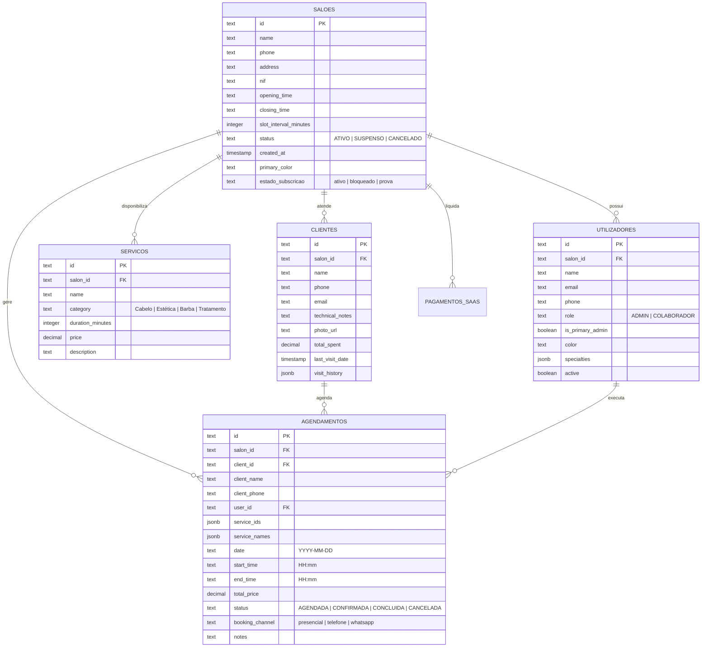

# SalãoMaster Pro - Sistema de Gestão & Agendamento para Salões de Cabeleireiro

[](https://github.com/CentauroPt/gestao-cabeleireiro)
[](https://react.dev/)
[](https://www.typescriptlang.org/)
[](https://vitejs.dev/)
[](https://tailwindcss.com/)
[](https://supabase.com/)
[](https://vercel.com/)
[](#-direitos-de-autor--propriedade-intelectual)
[](#-arquitetura-t%C3%A9cnica)

> **SalãoMaster Pro** é uma solução web corporativa de agendamento, fidelização de clientes e gestão empresarial desenvolvida à medida para salões de cabeleireiro, barbearias e espaços de estética. Projetada sob uma arquitetura **Multi-Tenant com isolamento rigoroso de dados**, combina controlo de acessos por funções (**RBAC**), agendamento inteligente com seleção obrigatória de canal de entrada, análise estatística de origens de reserva, gestão técnica de clientes (CRM), base de dados centralizada na nuvem com **Supabase (PostgreSQL + Realtime)** e sincronização multi-dispositivo instantânea.

---

## 📑 Índice Geral

1. [Visão Geral & Proposta de Valor](#-visão-geral--proposta-de-valor)
2. [Principais Módulos & Funcionalidades](#-principais-módulos--funcionalidades)
   - [1. Agenda de Marcações & Seleção de Canal de Reserva](#1-agenda-de-marcações--seleção-de-canal-de-reserva)
   - [2. Módulo de Estatística de Reservas](#2-módulo-de-estatística-de-reservas)
   - [3. CRM & Fichas Técnicas de Clientes](#3-crm--fichas-técnicas-de-clientes)
   - [4. Relatórios do Administrador & Faturação Real da Agenda](#4-relatórios-do-administrador--faturação-real-da-agenda)
   - [5. Gestão de Equipa & Controlo de Acessos (RBAC)](#5-gestão-de-equipa--controlo-de-acessos-rbac)
   - [6. Catálogo de Serviços & Tabela de Preços](#6-catálogo-de-serviços--tabela-de-preços)
   - [7. Base de Dados na Nuvem Supabase (PostgreSQL + Realtime)](#7-base-de-dados-na-nuvem-supabase-postgresql--realtime)
   - [8. Subscrição SaaS & Checkout Bancário Online](#8-subscrição-saas--checkout-bancário-online)
   - [9. Consola do Programador (Super Admin / Master)](#9-consola-do-programador-super-admin--master)
3. [Arquitetura Técnica & Stack Tecnológico](#-arquitetura-técnica--stack-tecnológico)
4. [Modelo de Dados & Esquema da Base de Dados](#-modelo-de-dados--esquema-da-base-de-dados)
5. [Instalação & Execução Local](#-instalação--execução-local)
6. [Variáveis de Ambiente](#-variáveis-de-ambiente)
7. [Publicação & Deploy (Vercel & GitHub Pages)](#-publicação--deploy)
8. [Segurança & Boas Práticas](#-segurança--boas-práticas)
9. [Direitos de Autor & Propriedade Intelectual](#-direitos-de-autor--propriedade-intelectual)

---

## 🎯 Visão Geral & Proposta de Valor

O **SalãoMaster Pro** resolve os desafios centrais da operação diária de um salão de beleza moderno:

- **100% Web & Responsivo:** Opera nativamente em qualquer navegador moderno (computadores, tablets e telemóveis) sem necessidade de instalação de binários ou executáveis locais.
- **Multi-Tenant Isolado:** Cada salão registado possui o seu identificador próprio (`salonId`), garantindo confidencialidade e total segregação de clientes, agendamentos, faturação e colaboradores.
- **Operação Híbrida Dual (Offline-First + Nuvem Supabase):** Mantém a operação em funcionamento ininterrupto mesmo sem internet através de persistência local de dupla camada (LocalStorage + IndexedDB), sincronizando em segundo plano com a base de dados **Supabase (PostgreSQL)** em tempo real.
- **Sincronização Multi-Dispositivo Realtime:** Marcações, clientes e alterações feitas num telemóvel refletem-se instantaneamente no computador da receção e no tablet através do motor **Supabase Realtime**.
- **Rastreabilidade de Canais de Marcação:** Identificação clara da proveniência de cada agendamento (Presencial, Chamada telefónica ou WhatsApp) com métricas financeiras associadas.

---

## 🌟 Principais Módulos & Funcionalidades

### 1. Agenda de Marcações & Seleção de Canal de Reserva
- **Janela Prévia de Seleção de Canal de Entrada:** Ao clicar em "+ Nova Reserva", ao selecionar qualquer horário vago da grelha diária/semanal ou ao iniciar marcação a partir da ficha do cliente, a primeira janela exibida obrigatoriamente é a escolha do canal de entrada:
  - 🏢 **Presencial** (cliente que entrou fisicamente no salão)
  - 📞 **Chamada telefónica** (reserva por voz)
  - 💬 **WhatsApp** (contacto direto por mensagem)
- **Vista de Balcão por Colaborador:** Distribuição visual diária em colunas dedicadas aos profissionais operacionais da equipa.
- **Vista em Lista Cronológica:** Acompanhamento sequencial de todas as marcações do dia com estados visuais claros (Agendada, Confirmada, Concluída, Cancelada).
- **Validação Anti-Sobreposição Estrita:** Cálculo dinâmico do término com base na soma dos tempos dos serviços selecionados. O sistema impede marcações simultâneas para o mesmo profissional.
- **Proteção Absoluta do Histórico de Reservas:**
  - Colaboradores e administradores podem criar, alterar e cancelar reservas ativas ou futuras.
  - **Reservas passadas nunca podem ser apagadas por ninguém**, salvaguardando a integridade histórica dos atendimentos e da faturação do salão.
  - As reservas passadas mantêm disponível o botão de conclusão para registo e fecho do atendimento.
- **Ocultação do Administrador Principal:** Nas listas de agendamento e seleção de operador, apenas surgem os colaboradores e profissionais técnicos operacionais, preservando a identidade executiva do titular do salão.

### 2. Módulo de Estatística de Reservas
- Bloco dedicado situado na secção de Administrador, imediatamente ao lado de "Estatísticas & Relatórios Financeiros", com a denominação **"Estatistica de reservas"**.
- **Canal Líder com Maior Volume:** Indicador de destaque em tempo real que assinala a origem dominante das reservas do salão.
- **Cartões de KPIs Detalhados:** Volume de reservas, percentagem da operação e total faturado (€) individualmente para **Presencial**, **Chamada telefónica** e **WhatsApp**.
- **Barra Visual de Distribuição:** Gráfico de barras proporcionais em percentagem demonstrando o peso de cada canal no fluxo do salão.
- **Filtros Temporais Ágeis:** Segmentação rápida por *Todo o Histórico*, *Hoje*, *Esta Semana*, *Este Mês* e *Últimos 30 dias*.
- **Tabela Analítica de Reservas:** Listagem detalhada com badge visual identificador do canal de entrada e pesquisa rápida por cliente.

### 3. CRM & Fichas Técnicas de Clientes
- **Ficha Técnica & Fórmulas:** Registo seguro de fórmulas de coloração, alergias (ex.: sensibilidade a amoníaco ou PPD), preferências de corte e notas confidenciais.
- **Histórico Completo de Visitas:** Registo consolidado de procedimentos realizados, datas, montantes pagos e profissional responsável.
- **Métricas de Fidelização:** Apresentação automática do volume total faturado (€), número de visitas e ticket médio por atendimento.
- **Alertas de Retenção & Reativação:**
  - 🟢 **Recente (< 30 dias):** Cliente assíduo e ativo.
  - 🟡 **Atenção (30 a 60 dias):** Próximo do limite do ciclo habitual de corte ou coloração.
  - 🔴 **Alerta / Ausente (+ 60 dias):** Notificação destacada com ligação direta para abertura de conversa no **WhatsApp** com mensagem pré-formatada.
- **Restrição de Eliminação Exclusiva a Administradores:** Apenas utilizadores com perfil `ADMIN` podem apagar fichas de clientes, prevenindo perdas acidentais ou não autorizadas.

### 4. Relatórios do Administrador & Faturação Real da Agenda
- **Sincronização Rigorosa com as Reservas Reais:** Todos os indicadores financeiros (Faturação Filtrada, Procedimentos Realizados, Ticket Médio, Clientes no Período, Vendas por Cliente, Vendas Diárias, Vendas Mensais e Vendas por Colaborador) têm como **fonte única de verdade as reservas reais ativas da agenda** (`appointments`).
- **Reconciliação Automática no Motor Central:** Ao carregar ou atualizar marcações, o motor de dados (`api.ts`) reconcilia o histórico de visitas e o `totalSpent` das fichas dos clientes, eliminando duplicados e impedindo valores fantasmas.
- **Exportação Formal A4:** Relatório para impressão ou PDF com cabeçalho corporativo, logótipo do salão, filtros aplicados e discriminação por procedimentos e colaboradores.

### 5. Gestão de Equipa & Controlo de Acessos (RBAC)
- **Papéis Distintos:**
  - **Administrador:** Acesso total à gestão financeira, relatórios, alteração de serviços, tabela de preços, eliminação de clientes e gestão de administradores.
  - **Colaborador:** Gestão de agenda, criação de clientes, marcação de reservas e conclusão de atendimentos, sem privilégios de eliminação crítica.
- **Gestão Administrativa & Promoção:** O Administrador Principal pode promover colaboradores a administradores auxiliares com palavra-passe dedicada de segurança, ou revogar tais acessos a qualquer momento.
- **Relatório de Vendas por Colaborador:** Monitorização de faturação individual, quantidade de atendimentos realizados e métricas de desempenho.

### 6. Catálogo de Serviços & Tabela de Preços
- Categorização de serviços (Cabelo, Barba, Coloração, Estética, Tratamentos).
- Duração configurável por serviço (em blocos de minutos).
- Definição de preço individual e descrição dos procedimentos.

### 7. Base de Dados na Nuvem Supabase (PostgreSQL + Realtime)
- **Armazenamento Central:** Base de dados PostgreSQL centralizada que alimenta em simultâneo a versão Vercel, dispositivos móveis e computadores de secretária.
- **Supabase Realtime:** Canais websocket bidirecionais ativos. Uma marcação inserida no telemóvel surge instantaneamente no computador sem recarregar a página.
- **Painel de Gestão da Nuvem na Consola do Programador:**
  - Teste de ligação em tempo real com contador de registos na nuvem.
  - Visualizador do script SQL completo com botão de cópia de 1 clique.
  - **Botão de Semeadura:** *"Enviar Todos os Dados Locais para a Nuvem Agora (Semear)"* para migrar imediatamente clientes e agendamentos deste computador para a nuvem.

### 8. Subscrição SaaS & Checkout Bancário Online
- **Ciclo de Subscrição:** Período de avaliação de 30 dias com contador decrescente.
- **Ecrã de Acesso Bloqueado:** Notificação clara de regularização com apresentação do valor da mensalidade do salão em EUR.
- **Métodos Suportados:** Cartão de Crédito/Débito, Referência Multibanco e MB WAY.
- **Painel de Pagamentos do Dono:** Listagem centralizada com histórico de transações, montante e timestamp de desbloqueio.

### 9. Consola do Programador (Super Admin / Master)
- Acesso restrito protegido por palavra-passe mestre.
- **Barra de Pesquisa Dedicada Superior:** Localização instantânea de salões pelo nome com contador de resultados em tempo real.
- **Gestão Global de Salões:** Visualização do estado de cada inquilino (Ativo, Prova, Bloqueado, Suspenso), com opção de suspensão justificada, eliminação ou personificação técnica.
- **Configuração Bancária Centralizada:** Definição global de IBAN, número de telemóvel MB Way, contacto de suporte WhatsApp e valor mensal padrão para novos salões.
- **Painel de Estatísticas SaaS:** MRR (Receita Mensal Recorrente), salões ativos, taxas de conversão e pagamentos validados.

---

## 🏗️ Arquitetura Técnica & Stack Tecnológico

```
┌────────────────────────────────────────────────────────────────────────┐
│                        FRONTEND (SPA - React 19)                       │
│  React 19 • TypeScript 6 • Tailwind CSS v4 • Lucide Icons • date-fns   │
├────────────────────────────────────────────────────────────────────────┤
│                     CAMADA DE ESTADO & SERVIÇOS                        │
│  AppContext (Multi-Tenant Context) • ApiService • SupabaseService      │
│  Sincronização Reativa: Supabase Realtime • StorageEngine • Broadcast  │
├───────────────────────────────────┬────────────────────────────────────┤
│       ARMAZENAMENTO LOCAL         │         NUVEM & BACKEND            │
│  LocalStorage + IndexedDB Cache   │  Supabase (PostgreSQL 15+)         │
│  (Resiliência Offline-First)      │  Supabase Realtime WebSockets      │
│                                   │  Gateway Bancário (Stripe / MBWay) │
└───────────────────────────────────┴────────────────────────────────────┘
```

| Componente | Tecnologia | Finalidade |
| :--- | :--- | :--- |
| **Biblioteca de UI** | React 19.2 | Renderização de interfaces declarativas com hooks modernos |
| **Linguagem** | TypeScript 6.0 | Tipagem estática rigorosa para prevenção de falhas em runtime |
| **Compilador / Bundler**| Vite 8.3 | Servidor de desenvolvimento ultrarrápido e compilação otimizada |
| **Estilos & Design** | Tailwind CSS v4.3 | Motor utilitário CSS com design system sóbrio e responsivo |
| **Ícones** | Lucide React | Biblioteca leve de ícones SVG consistentes |
| **Manipulação de Datas**| date-fns 4.4 | Formatação, comparações e cálculos temporais |
| **Base de Dados Central**| Supabase (PostgreSQL 15+) | Armazenamento relacional estruturado com publicação Realtime |
| **Sincronização em Tempo Real**| Supabase Realtime | Propagação instantânea de marcações e clientes entre dispositivos |
| **Persistência Offline**| LocalStorage + IndexedDB | Funcionamento 100% contínuo mesmo com quebra de rede |
| **Hospedagem / Deploy** | Vercel & GitHub Pages | Servidor de alta performance com suporte a SPA rewrites |

---

## 📊 Modelo de Dados & Esquema da Base de Dados

O esquema relacional é composto por 5 tabelas centrais operacionais e tabelas de gestão SaaS:



---

## 💻 Instalação & Execução Local

### Pré-requisitos
- **Node.js**: Versão 18.x, 20.x ou superior.
- **npm** (v9+) ou **pnpm** / **yarn**.
- Git configurado no sistema.

### 1. Clonar o Repositório
```bash
git clone https://github.com/CentauroPt/gestao-cabeleireiro.git
cd gestao-cabeleireiro
```

### 2. Instalar as Dependências
```bash
npm install
```

### 3. Configurar as Variáveis de Ambiente
Crie o ficheiro `.env` a partir do modelo de exemplo:
```bash
cp .env.example .env
```
Insira as credenciais do seu projeto Supabase:
```ini
VITE_SUPABASE_URL=https://ixpislhiomtbapjltahl.supabase.co
VITE_SUPABASE_ANON_KEY=sb_publishable_L2qxROhDV4CH6t1mn47B6g_n8d8Kwh0
```

### 4. Iniciar o Servidor de Desenvolvimento
```bash
npm run dev
```
Aceda no seu navegador a: `http://localhost:5173`.

### 5. Compilar para Produção
```bash
npm run build
```
Os ficheiros minificados e otimizados para produção serão gerados no diretório `dist/`.

---

## ⚙️ Variáveis de Ambiente

As configurações de ligação à nuvem podem ser especificadas no ficheiro `.env` ou nas variáveis do painel da **Vercel**:

```ini
# Ligação à Base de Dados Central na Nuvem (Supabase PostgreSQL + Realtime)
VITE_SUPABASE_URL=https://ixpislhiomtbapjltahl.supabase.co
VITE_SUPABASE_ANON_KEY=sb_publishable_L2qxROhDV4CH6t1mn47B6g_n8d8Kwh0

# Endpoint de API REST Backend (Opcional - caso utilize servidor dedicado)
# Deixe em branco para utilizar o motor integrado com sincronização Supabase
VITE_API_BASE_URL=
```

> [!NOTE]
> Se as variáveis do Supabase não forem fornecidas, o **SalãoMaster Pro** ativa de forma automática e transparente o seu **motor local de persistência (LocalStorage + IndexedDB)**, permitindo operação completa e autónoma mesmo offline.

---

## 🚀 Publicação & Deploy

### Vercel (Produção em Nuvem)
O projeto inclui o ficheiro de configuração [`vercel.json`](file:///C:/Servidor_Web/vercel.json) configurado para construir via `npm run build` com pasta de saída `dist/` e regras de reescrita SPA:
1. Conecte o repositório GitHub `CentauroPt/gestao-cabeleireiro` na consola da [Vercel](https://vercel.com).
2. Nas configurações de ambiente (*Environment Variables*), adicione:
   - `VITE_SUPABASE_URL`
   - `VITE_SUPABASE_ANON_KEY`
3. A Vercel executa o deploy automático a cada push para o ramo `main`.

### GitHub Pages
O repositório está configurado para entrega contínua através do ramo `gh-pages` com suporte a SPA através de `404.html`:
```bash
npm run build
Copy-Item -Force dist\index.html dist\404.html
# Publicar o conteúdo da pasta dist no ramo gh-pages
```

---

## 🛡️ Segurança & Boas Práticas

1. **Permissões Granulares por Perfil (RBAC):**
   A validação de permissões ocorre na interface gráfica e na camada de dados (`currentUser.role === 'ADMIN'`). Apenas administradores podem eliminar clientes, editar preços ou aceder à faturação consolidada.
2. **Proteção Histórica de Dados:**
   Marcações anteriores ao horário corrente encontram-se protegidas por regra lógica universal, impedindo a adulteração de históricos de faturação.
3. **Persistência em Camadas Resiliente:**
   Se a rede falhar, os dados são guardados localmente de imediato no LocalStorage e no IndexedDB, sendo enviados para o Supabase assim que a ligação é restabelecida.
4. **Isolamento Multi-Tenant:**
   Todas as consultas e gravações são indexadas e filtradas por `salonId`, prevenindo qualquer acesso cruzado entre estabelecimentos.

---

## ⚖️ Direitos de Autor & Propriedade Intelectual

**Copyright © 2026 José Centúrio. Todos os direitos reservados.**

Todo o código-fonte, arquitetura de software, design de interfaces, base de dados e documentação associada a este projeto são da titularidade e propriedade intelectual exclusiva de **José Centúrio**.

É expressamente proibida a reprodução, distribuição, modificação, engenharia reversa ou comercialização total ou parcial deste software sem a autorização prévia, expressa e por escrito do respetivo autor.
